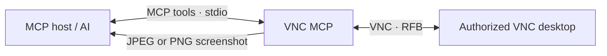

<div align="center">

# VNC MCP

Local VMware source deployment: use the pinned source with the isolated `.venv` and `main.py`; no upstream executable is installed or validated here. See [LOCAL-CHANGES.md](LOCAL-CHANGES.md) and [codex-mcp.toml](codex-mcp.toml) for the active configuration. The executable packaging instructions below describe the upstream distribution.


[](LICENSE)

**Let your MCP-compatible AI see and control a VNC desktop.**

Screenshot-based desktop control, packaged as a Windows executable.

[Features](#features) · [Quick start](#quick-start) · [MCP setup](#mcp-setup) · [CLI](#cli) · [License](#license)

</div>

---

## At a glance

| | |
| --- | --- |
| **Interface** | MCP over stdio, plus a command-line interface |
| **VNC library** | `vncdotool` |
| **Platform** | Packaged executable for 64-bit Windows |
| **Runtime setup** | Python and VNC modules are bundled in the executable |
| **Initial developer credit** | Shinko (one of the project's initial developers) |



## Features

- Inspect the remote screen with native-resolution JPEG screenshots (PNG is optional), including bounded regions with explicit origins.
- Click, move, drag, and scroll the mouse.
- Press, hold, and release keys; type text.
- Send clipboard text and read the latest text announced by the VNC server.
- Keep independent named desktop connections open for MCP actions, or run one-off CLI commands.
- Connect with or without a VNC password.

> VNC input directly controls the remote computer. Connect only to systems you are authorized to use.

## Quick start

### 1. Get the executable

Download and extract `vnc-mcp-win-x64.zip`, or build it yourself on Windows with Python 3.14:

```powershell
py -3.14 --version
.\build.ps1
```

The build creates `dist/vnc-mcp.exe` and `dist/vnc-mcp-win-x64.zip`. The ZIP contains both the single-file executable and an onedir build in `vnc-mcp/`, with the README, license, and attribution notice.

### 2. Add the MCP server

Add this entry to your MCP host configuration. Replace the executable path with where you extracted it:

```json
{
  "mcpServers": {
    "vnc": {
      "command": "C:\\path\\to\\vnc-mcp.exe",
      "args": ["mcp"],
      "env": {
        "VNC_HOST": "127.0.0.1",
        "VNC_PORT": "5900",
        "VNC_PASSWORD": ""
      }
    }
  }
}
```

Restart or reload the MCP host. Connect with explicit host and port, then call `vnc_screenshot` to view the desktop. Coordinates always refer to the native desktop. For a cropped screenshot add its origin to image-local coordinates. Pass the returned `connection_id` to later actions to reject stale targets, then take another screenshot to confirm the result.

Use a distinct `session_id` for each desktop, for example `WIN11` and `WIN10`. Except for connect/status/inventory, tools on a named session require both its `session_id` and returned `connection_id`. Omitting `session_id` uses the separate legacy `default` session; it never selects the most recently connected named desktop. Reconnecting a name changes only that session and invalidates its previous connection ID.

Example MCP calls (use the connection IDs returned by your own connects):

```python
vnc_connect(host="127.0.0.1", port=5901, session_id="WIN11")
vnc_screenshot(session_id="WIN11", connection_id="<WIN11 connection_id>")
vnc_connect(host="127.0.0.1", port=5902, session_id="WIN10")
vnc_screenshot(session_id="WIN10", connection_id="<WIN10 connection_id>")
vnc_sessions()
```

Each session has its own queue, with at most 16 outstanding calls including async waits. By default up to four sessions may be open, including `default` when used. Disconnecting releases capacity; inactive sessions expire after five minutes (cleanup scans at most every 30 seconds). Active/queued calls and waits prevent expiry. Expiry releases held input; reconnect explicitly and inspect the screen again. `vnc_sessions` returns cached status without waiting for busy desktops; use `vnc_status(session_id=...)` for current state.

### 3. Protect credentials

The password is optional. Prefer your MCP host's protected environment or secret settings for `VNC_PASSWORD`; avoid saving real credentials in shared config files.

## MCP setup

The MCP server communicates over **stdio** and does not open a listening port. Set these optional environment variables in the MCP host:

| Variable | Default | Purpose |
| --- | --- | --- |
| `VNC_HOST` | None | Default VNC host; can instead be passed to `vnc_connect`. |
| `VNC_PORT` | None | Optional default port; otherwise pass it explicitly. VMware ports normally start at 5901. |
| `VNC_PASSWORD` | None | Password for VNC servers that require one. |
| `VNC_PASSWORD_ENV` | `VNC_PASSWORD` | Name of the environment variable containing the password. |
| `VNC_TIMEOUT` | `15` | VNC operation timeout in seconds. |
| `VNC_SCREENSHOT_MODE` | `refresh` | Use `fresh` for VMware servers that do not answer repeated full refreshes. |
| `VNC_ACTION_TIMEOUT` | `20` | Cooperative action budget in seconds; values must be positive, finite, and at most 60. |
| `VNC_MAX_SESSIONS` | `4` | Maximum independent sessions, including the legacy default when used; integer 1-32. |
| `VNC_IDLE_TIMEOUT` | `300` | Seconds since the last completed call before idle cleanup; 0 disables expiry, maximum 86400. |

### Available tools

| Group | Tools |
| --- | --- |
| Connection | `vnc_connect`, `vnc_disconnect`, `vnc_status`, `vnc_sessions` |
| Screen | `vnc_screenshot`, `vnc_wait` |
| Pointer | `vnc_click`, `vnc_move`, `vnc_drag`, `vnc_scroll`, `vnc_mouse_down`, `vnc_mouse_up` |
| Keyboard | `vnc_keypress`, `vnc_key_down`, `vnc_key_up`, `vnc_type` |
| Clipboard | `vnc_clipboard_set`, `vnc_clipboard_get` |

**Suggested interaction:** connect → screenshot → act using native pixel coordinates → screenshot again to verify.

## CLI

Each CLI command connects, performs one action, prints a JSON result, then disconnects. Password prompts require explicit `--ask-password`. For scripts, set `VNC_PASSWORD` or use `--password-env NAME`; absent a password the CLI tries a passwordless connection. It never infers interactive intent from `isatty()`.

Local source examples from this deployment directory:

```powershell
.\.venv\Scripts\python.exe main.py screenshot --host 127.0.0.1 --port 5901 --screenshot-mode fresh --format jpeg --region 470 300 740 420 --output screen.jpg
.\.venv\Scripts\python.exe main.py screenshot --host 127.0.0.1 --port 5902 --screenshot-mode fresh --output screen.png
```

```powershell
.\vnc-mcp.exe --help
.\vnc-mcp.exe screenshot --host 127.0.0.1 --port 5900 --output screen.png
.\vnc-mcp.exe click --host 127.0.0.1 --port 5900 430 280
.\vnc-mcp.exe keypress --host 127.0.0.1 --port 5900 ctrl-alt-delete
.\vnc-mcp.exe type --host 127.0.0.1 --port 5900 "hello world"
.\vnc-mcp.exe drag --host 127.0.0.1 --port 5900 40 80 300 240
.\vnc-mcp.exe scroll --host 127.0.0.1 --port 5900 400 400 down --amount 3
.\vnc-mcp.exe clipboard-set --host 127.0.0.1 --port 5900 "hello world"
.\vnc-mcp.exe clipboard-get --host 127.0.0.1 --port 5900
```

The executable examples above are upstream packaging examples. CLI commands require both `--host` and `--port`. Local source commands use the isolated Python and `main.py`, as shown above. Use MCP for a persistent session across multiple actions.

## Run from source

Python 3.10 or later can run the project without the packaged executable:

```powershell
py -m pip install -r requirements.txt
py main.py --help
py main.py mcp
```

Direct runtime dependencies: `vncdotool==1.4.2` and `mcp==1.30.0`. `build.ps1` uses PyInstaller to bundle the app and its runtime dependencies.

## License

The original project code is available under the [Apache License, Version 2.0](LICENSE). You may use, modify, and redistribute it, including commercially, subject to that license. Keep the accompanying [`NOTICE`](NOTICE) attribution when redistributing this project or derivative works: **“Shinko is one of the initial developers of VNC MCP.”**

Third-party dependencies included in the executable remain under their own licenses.

---

<div align="center">
Made with care by the VNC MCP contributors · Early development credit: Shinko
</div>
